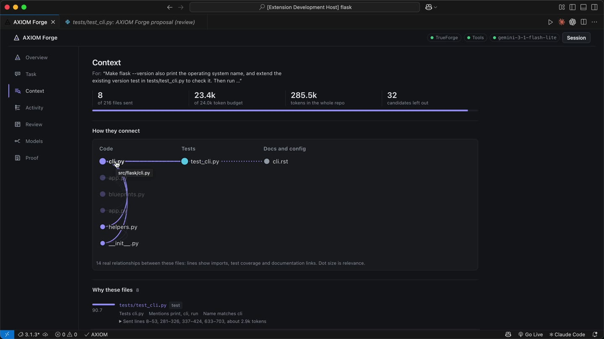
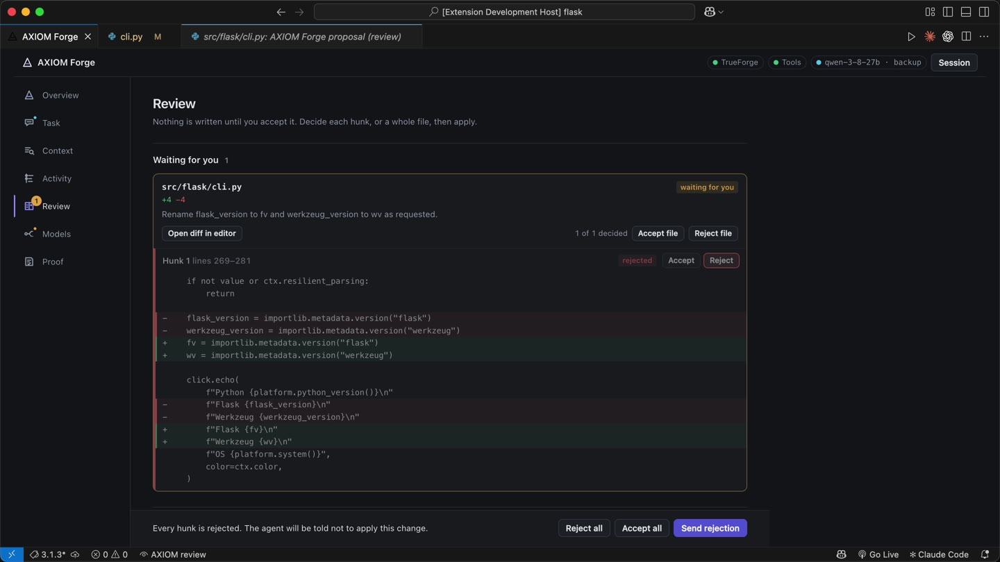
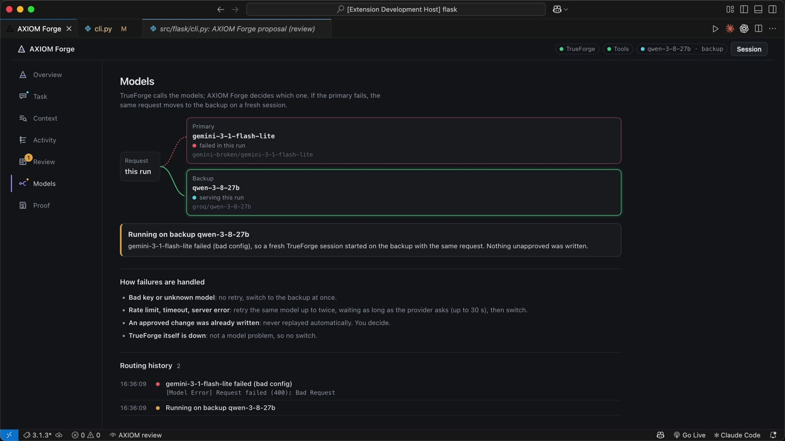
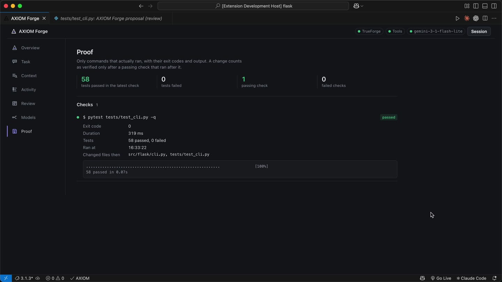
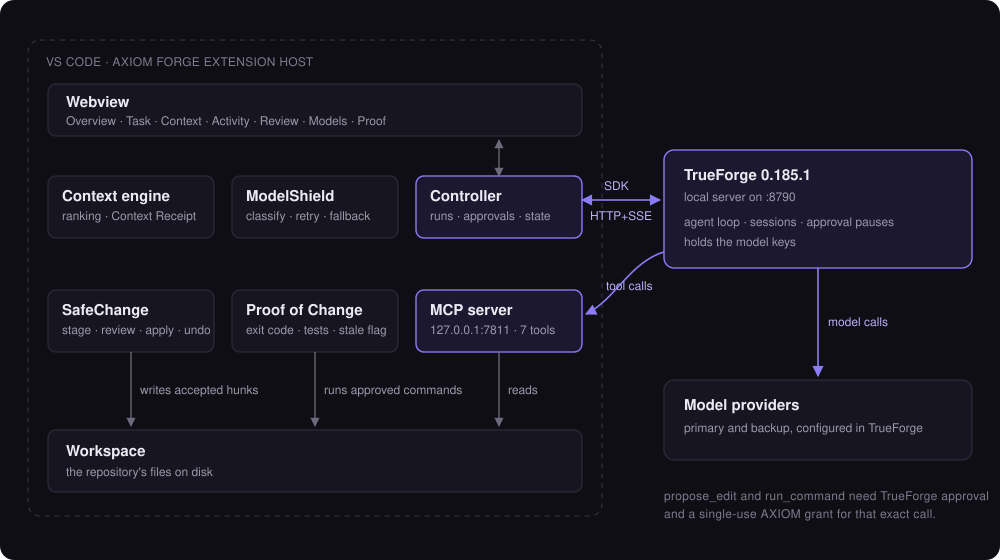

<h1 align="center">AXIOM Forge</h1>

<p align="center"><b>Understand the code. Justify every change. Verify before delivery.</b></p>

<p align="center">
AXIOM Forge is a VS Code extension that runs a coding agent through <a href="https://github.com/truefoundry/trueforge">TrueForge</a>. It picks the files that matter in a large repository and says why it picked them. Every hunk and every command waits for your approval, and the test run that checks the result is recorded with its exit code.
</p>

<p align="center">
  <a href="#see-axiom-forge-in-action">Demo</a> ·
  <a href="#getting-started">Getting started</a> ·
  <a href="#architecture">Architecture</a> ·
  <a href="docs/VALIDATION.md">Validation</a> ·
  <a href="docs/README.md">Docs</a>
</p>


## The problem

When an agent changes a repository that is larger than its context window, the developer usually can't see:

- which files the model actually read, and which it never saw;
- why each change was made, at the level of individual hunks;
- what ran on their machine, and whether anything checked the result.

So the choice comes down to accepting a large diff on trust or redoing the work. AXIOM Forge makes each of those steps visible, and keeps every write and command under the developer's control.

## Core capabilities

- **Repository context.** Ranks the files with BM25, path and identifier matches, the import graph and test/doc pairing, within a 24k-token budget.
- **Context Receipt.** Shows the files sent to the model, the reason each one was included, and the candidates left out.
- **Inline edit.** Select code, press <kbd>⌘I</kbd> / <kbd>Ctrl+I</kbd> and describe the change; the diff opens in the editor with Accept/Reject on each hunk.
- **Agent mode.** Describe a task without naming files. The agent reads, searches and proposes changes across several files.
- **SafeChange.** Nothing is written until you accept hunks and apply them. A change set is applied all together or rolled back, and Undo checks the file before restoring it.
- **ModelShield.** When a provider fails, it retries what can be retried and otherwise moves to a backup model in a fresh session. It never replays a step that already changed files.
- **Proof of Change.** Approved test commands run without a shell, and their exit code, test counts and output are stored. A proof is marked stale once a later change is applied.

## Screenshots

From the live recording on Flask (18 Nov 2026). The data in them is real.

| | |
|---|---|
|  |  |
| **Context Receipt.** 8 of 216 files sent (23.4k of 24k tokens), and how they relate. | **Review.** Each hunk is accepted or rejected before anything is written. |
|  |  |
| **ModelShield.** The primary failed with a bad key, so the run continued on the backup. | **Proof of Change.** `pytest tests/test_cli.py`: 58 passed, exit code 0. |

## Architecture

<p align="center"></p>

- **TrueForge** (local, port 8790) runs the agent loop, makes every model call and holds the provider keys. AXIOM Forge never calls a model provider itself.
- **The extension** creates TrueForge sessions with `@truefoundry/trueforge-sdk`, streams their events into the UI, and answers approval pauses.
- **The MCP server** runs inside the extension host on `127.0.0.1` and gives the agent seven tools: `read_file`, `search_workspace`, `find_symbol`, `related_files`, `assemble_context`, `propose_edit` and `run_command`. The last two need TrueForge approval **and** a single-use AXIOM grant for that exact call.

Full design, tool contracts and the approval sequence: [docs/ARCHITECTURE.md](docs/ARCHITECTURE.md).

## How it works

1. **Task.** You describe a change in the workspace view, or select code and press ⌘I.
2. **Context.** The context engine ranks the repository and assembles a budgeted context. The Context Receipt records what was sent and why.
3. **Agent.** The controller starts a TrueForge session. The agent reads and searches through the MCP tools, and its steps stream into the Task and Activity views.
4. **Proposal.** When the agent calls `propose_edit`, SafeChange stages the diff against the current file contents, and the turn pauses.
5. **Review.** You accept or reject each hunk. Rejecting everything sends the agent a reason instead of a write.
6. **Apply.** The accepted hunks across all files are written together. If one write fails, the files already written are restored.
7. **Verify.** If the agent asks to run a test command, you approve that exact command. The result becomes a Proof entry, and it goes stale if a later change is applied.

If the model fails at any point, ModelShield decides whether to retry, switch to the backup or stop. The Models view shows that routing history.

## Getting started

**Prerequisites:**

- macOS (the only platform tested);
- Node.js 22.14 or newer;
- VS Code 1.100 or newer;
- Python 3.10+ and git, for the Flask sample repository;
- at least one model provider you can add to TrueForge (free tiers work, with limits).

**Steps:**

1. **Install and build:**
   ```bash
   git clone https://github.com/Manthan122006/AXIOM-FORGE.git
   ```
   ```bash
   cd AXIOM-FORGE && npm run setup
   ```
   This installs dependencies, builds the extension and the webview, and downloads Flask 3.1.3 into `fixtures/flask` with its own virtualenv.
2. **Start TrueForge** in a second terminal, and leave it running:
   ```bash
   OUTBOUND_URL_ALLOWED_HOSTS='["127.0.0.1"]' npx -y @truefoundry/trueforge@0.185.1
   ```
   The allowlist lets TrueForge reach the extension's MCP server on loopback only.
3. **Configure models.** Open http://localhost:8790 → Settings → Models and add a primary and, optionally, a backup (for example Google Gemini and Groq as a custom OpenAI-compatible provider). Keys stay in TrueForge. See [config/models.example.json](config/models.example.json).
4. **Launch.** Open the cloned folder in VS Code and press **F5** with *Run AXIOM Forge (Flask fixture)*. If you skipped Python, use *Run AXIOM Forge (on its own source, no Flask needed)*. A second window, the Extension Development Host, opens.
5. **Register.** In that window, run Command Palette → **AXIOM Forge: Register MCP Server and Agent in TrueForge**, then pick the primary model. For fallback, set `axiomForge.models.backup` in Settings. On free tiers, also set `axiomForge.pacing.minSecondsBetweenSteps` (for example 16 on Gemini).
6. **Preflight.** `npx tsx scripts/preflight.ts --primary <model> --backup <model>` checks the agent definitions, TrueForge, the model names and the MCP tool listing. It makes no model calls.
7. **Try it.** Open AXIOM Forge from the activity bar and run a task.

A detailed walkthrough and a troubleshooting table are in [RUN_IN_VSCODE.md](RUN_IN_VSCODE.md).

## Testing and verification

| Command | What it checks | Needs a model? |
|---|---|---|
| `npm run check` | typecheck, lint, unit tests, production build | no |
| `npm run test:vscode` | the extension inside a real VS Code: MCP, approvals, SafeChange apply/undo/rollback, diff and CodeLens, failure handling. If VS Code isn't in `~/Applications`, set `VSCODE_EXECUTABLE` | no (2 opt-in live tests do) |
| `npx tsx scripts/eval-retrieval.ts` | context ranking on 33 Flask tasks, including 8 never used for tuning | no |
| `bash scripts/tasks/verify-task-{a,b,c}.sh` | checks the Flask fixture after an agent run (Tasks A, B, C) | the run that precedes it does |
| `bash scripts/check-publish.sh` | no keys, private data or local files tracked, in files or history | no |

**Latest results (19 Nov 2026):**

- `npm run check`: 219/219 unit tests.
- `npm run test:vscode`: 13 passing, 2 pending (the opt-in live tests).
- Retrieval: 25 of 33 tasks have every expected file in the top 5, and 5 of 8 fresh tasks do.
- Live runs with real models (18 Nov) verified approve, deny and cancel, a real 429 falling back to the backup, and Task A.
- **Task B doesn't pass yet** (best: 4 of 5 checks).

Details and evidence: [docs/VALIDATION.md](docs/VALIDATION.md).

## Security

- **Network:** the MCP server binds to `127.0.0.1` only, and refuses requests with a browser `Origin` or a foreign `Host` header.
- **Files:** tool access is limited to the open workspace folder. Path traversal, symlinks pointing outside it, `.env` files, key files and `.git` are refused.
- **Approvals:** writes and commands each need two approvals: TrueForge's approval pause and a single-use AXIOM grant that matches the exact call.
- **Commands:**
  - only an allowlist of programs can run: `python`, `pytest`, `flask`, `node`, read-only `git`, `npm test`/`run`, and `npx vitest`/`tsc`/`eslint`;
  - there's no shell, so pipes, redirects and `$` are refused;
  - every command has a timeout, and secrets are scrubbed from its output.
- **What it doesn't do:** commands aren't sandboxed. An approved `python -c …` can do whatever the workspace's Python can. This is a local development tool and it hasn't had an independent security review.

## Known limitations

- Task B, the hardest Flask task, doesn't pass end to end yet.
- Retrieval is lexical and structural (no embeddings, no language server), and the token budget is an estimate.
- The backup model starts a fresh session, without the failed turn's reasoning.
- Applying a change set is all-or-nothing with rollback, but not crash-atomic.
- Free-tier quotas slow long agent runs down or make them fail.
- Tested on macOS with VS Code 1.125 only.

Full list: [docs/KNOWN_LIMITATIONS.md](docs/KNOWN_LIMITATIONS.md).

## Technology

| Runtime | Role |
|---|---|
| VS Code extension API (`^1.100.0`), TypeScript | extension host, native diff, per-hunk CodeLens |
| React 19 | the webview (sidebar and full-size workspace tab) |
| TrueForge 0.185.1 + `@truefoundry/trueforge-sdk` | agent loop, model calls, sessions, approvals |
| `@modelcontextprotocol/sdk` | the MCP server (Streamable HTTP) |
| `diff` (jsdiff), `zod` | hunks and merging; validating tool arguments |

**Development tools:** esbuild and Vite (builds), Vitest (unit tests), Mocha with `@vscode/test-electron` (VS Code tests), ESLint and Prettier.

## Team

Team AXIOM, for the TrueFoundry Forge-a-thon (Techfest 2026–27, IIT Bombay).

| Member | Area |
|---|---|
| Manthan Chandulal Gajra | architecture, TrueForge integration, final integration |
| Vivan Jain | webview UI, design system, motion |
| Toheed Inamdar | MCP server, workspace safety, SafeChange |
| Kunjal | context engine, retrieval quality, QA |

These areas are as assigned in [the team plan](docs/historical/TEAM_ASSIGNMENTS.md).

**Development note:** the code was written with Claude Code as an AI coding assistant, in sessions on Manthan's machine, so every commit on `main` carries his name.

## License and acknowledgments

MIT, see [LICENSE](LICENSE).

AXIOM Forge builds on:

- TrueForge (MIT, TrueFoundry);
- the Model Context Protocol TypeScript SDK (MIT);
- jsdiff (BSD-3-Clause);
- zod (MIT);
- React (MIT).

The demo video uses music by Sascha Ende (CC BY 4.0), sound effects by Kenney (CC0) and a Kokoro voice. The sample repository is [pallets/flask](https://github.com/pallets/flask) (BSD-3-Clause).
